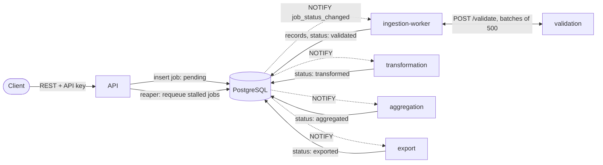

# Pipeline architecture

## Flow

Job statuses move through
`pending → processing → validated → transforming → transformed → aggregating → aggregated → exporting → exported`,
or to `failed` from any active status.

## Interaction model

The pipeline uses **background workers with PostgreSQL as the job queue**.

- Each stage worker (`ingestion-worker`, `transformation`, `aggregation`,
  `export`) runs on the shared runtime in `packages/worker`. It claims the
  oldest job in its input status with `SELECT … FOR UPDATE SKIP LOCKED`,
  so replicas never process the same job, and keeps `heartbeat_at` fresh
  while it works.
- Workers do not poll every few seconds. Migration 013 adds a trigger that
  sends `pg_notify('job_status_changed', <new status>)` on every status
  change; workers `LISTEN` on that channel and wake immediately. A slow
  fallback check (`WORKER_POLL_INTERVAL`, default 30s) covers missed
  notifications.
- The API runs a reaper (`packages/jobs/reaper.go`) that moves jobs with a
  stale heartbeat back to their previous status, or marks them failed
  after `JOB_MAX_RETRIES`.

### Why validation stays an HTTP service

Validation is the only synchronous step: the ingestion worker sends it
bounded batches (500 records, at most 4 MiB) and stores the results in
the same transaction that advances progress. Keeping it as a stateless
HTTP service lets it scale independently of ingestion and keeps the
ingestion worker free of validation rules. It has no database access and
no queue of its own, so it does not need the worker runtime.

Transformation previously exposed an unused `POST /transform` endpoint in
addition to its worker loop; that endpoint has been removed so every
stage after validation follows the same worker model.

## Memory use

Ingestion streams its input. CSV files are read row by row and JSON
arrays element by element; records go to validation in batches of 500 and
are written to `job_records` per batch. The input is read once to count
records (for progress reporting) and once to process them, so memory use
does not grow with file size. API sources are capped at 10 MiB per
response and are fetched up front, at most three at a time.

## Future work: object storage

Intermediate and output files (`transformed`, `aggregated`, `final
report`) are written to the `transformation_output` volume shared by the
workers, and uploads to the `uploads_data` volume shared by the API and
ingestion. That works on a single Docker host but not across nodes. The
next step is to store these files in S3-compatible object storage (for
example MinIO locally) and keep only object keys in the `jobs` table.

## Observability

- **Logs**: `log/slog` through `packages/logger`. `LOG_FORMAT=json` (set in
  Docker Compose) emits one JSON object per line with `service`, and where
  relevant `request_id`, `job_id`, `stage`, `record_count` and
  `duration_ms`. API responses carry `X-Request-ID`.
- **Metrics**: every API and worker process serves Prometheus metrics on
  `METRICS_PORT` (9090, internal only); validation serves them on its own
  port. Main series: `pipeline_jobs_total{stage,status}`,
  `pipeline_stage_duration_seconds{stage}`,
  `pipeline_records_processed_total{stage}`,
  `pipeline_errors_total{stage}`, `pipeline_jobs_in_status{status}`,
  `pipeline_jobs_recovered_total{stage,outcome}`, `http_requests_total` and
  `http_request_duration_seconds`.
- **Health**: `GET /v1/health` on the API and `GET /health` on every
  worker check database connectivity and return 503 when it fails.
